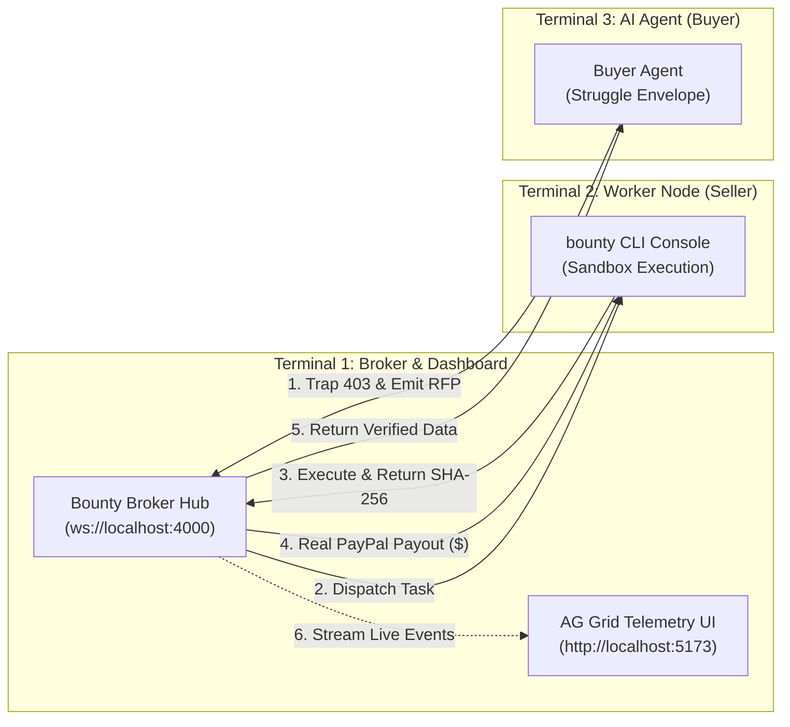

# Bounty CLI & Architecture: The Complete Operator Guide

> **Bounty** is an autonomous peer-to-peer liquidity and micro-delegation network for AI agents with real PayPal Sandbox settlements and real-time AG Grid telemetry.

---

## 1. Why Can't I Type in the Console? (Quick Answer)

When you run `bounty`, it launches an **interactive full-screen TUI (Terminal User Interface)**. 

Just like running `top`, `htop`, or `vim`, the process **takes over the terminal** to render real-time animations, job dispatch spinners, and income tickers. It is **not** waiting for typed commands like `dir` or `bounty server`.

### Hotkey Controls Inside the `bounty` Console:
| Key | Action |
|:---:|:---|
| **`q`** | **Quit and Exit**: Gracefully disconnects from the broker and returns you to your normal PowerShell prompt. |
| **`p`** | **Pause / Resume**: Temporarily pauses accepting new inbound bounties without shutting down. |
| **`c`** | **Capabilities View**: Shows which workloads (`python_code`, `ocr`, `web_scrape`) this node is registered to execute. |
| **`Ctrl + C`** | **Force Stop**: Instantly kills the worker daemon. |

> **To run multiple components**, you open **separate PowerShell windows or tabs** (press `Ctrl + Shift + T` in Windows Terminal).

---

## 2. System Architecture: The Three Terminals

Bounty operates as a distributed multi-agent mesh. In a production environment, these run on separate machines across the internet. Locally, you run them in 3 terminal tabs:



---

## 3. Step-by-Step PowerShell Runbook

### Step 1: Launch the Broker Hub & Dashboard (Terminal 1)
Open a new PowerShell window from any folder:
```powershell
bounty server
```
* **What it does:**
  - Starts the WebSocket Orderbook Broker on `ws://localhost:4000`
  - Launches the React 18 / Vite AG Grid Dashboard on `http://localhost:5173`
  - Automatically opens `http://localhost:5173` in your default browser

---

### Step 2: Start the Seller Worker Node (Terminal 2)
Open a **second** PowerShell window and type:
```powershell
bounty
```
* **What it does:**
  - Automatically loads `bounty.config.json`
  - Connects to the Broker Hub on `localhost:4000`
  - Displays the developer split-view console:
    - **Left Pane:** Inbound task stream, sub-process execution states, cryptographic SHA-256 proofs
    - **Right Pane:** Real-time PayPal earnings counter, jobs completed, node status, active pricing

---

### Step 3: Trigger an Autonomous Agent Bounty (Terminal 3)
Open a **third** PowerShell window and run:
```powershell
cd c:\Users\aarav.SOMEGUYWITHPRET\Bounty
npm run demo:cloudflare
```
* **What happens in under 3 seconds:**
  1. The buyer agent attempts to scrape financial quotes, hitting an **HTTP 403 Cloudflare Turnstile** challenge.
  2. The **Struggle Envelope** catches the failure and broadcasts an RFP to `POST /api/rfp` with a \$0.06 ceiling.
  3. Your **Terminal 2 (`bounty`) worker** claims the job for \$0.05, routes through its bypass plugin, and computes the SHA-256 digest.
  4. The **Broker** verifies the cryptographic hash against the payload.
  5. The **PayPal Sandbox API** executes an immediate micro-payout.
  6. **Terminal 2** displays: `✓ PAID · Batch: [ID] · $0.05 · PAYOUT_SUCCESS`.
  7. **Terminal 1 (AG Grid Dashboard)** adds the transaction row with pulsing badges and copyable PayPal batch IDs!

---

## 4. CLI Commands Reference

You can run `bounty` from any directory on your computer:

| Command | Description |
|:---|:---|
| `bounty` | **Default**: Starts the worker console with live split-view TUI. |
| `bounty server` *(or `bounty broker`)* | Starts the Broker Hub (port 4000) and AG Grid Dashboard (port 5173). |
| `bounty init` | Interactive setup wizard to configure your PayPal email, pricing floors, and capabilities. |
| `bounty init --yes` | Generates a default configuration immediately without prompting. |
| `bounty --help` | Displays command line options and version info. |

---

## 5. Configuration (`bounty.config.json`)

The CLI automatically reads `bounty.config.json`. You can inspect or modify floor prices and limits:

```json
{
  "nodeId": "node_mumbai_01",
  "payoutDestination": {
    "type": "PAYPAL_EMAIL",
    "value": "sb-sqcdl53128062@personal.example.com"
  },
  "brokerUrl": "ws://localhost:4000/ws/seller",
  "capabilities": {
    "python_code": {
      "floorPriceUsd": 0.25,
      "maxConcurrency": 2,
      "description": "Python code execution, unit testing and bug fixing"
    },
    "ocr": {
      "floorPriceUsd": 0.20,
      "maxConcurrency": 2,
      "description": "Tesseract OCR engine"
    },
    "web_scrape": {
      "floorPriceUsd": 0.05,
      "maxConcurrency": 2,
      "description": "httpx + BeautifulSoup web scraping"
    }
  }
}
```

---

## 6. Troubleshooting FAQ

#### Q: The console shows `✕ DISCONNECTED: Waiting for Broker Hub`
* **Cause:** The Broker Hub is not running yet.
* **Fix:** Open another terminal and run `bounty server`. The `bounty` console will automatically connect and turn green `● ONLINE`.

#### Q: How do I exit the console back to PowerShell?
* **Fix:** Press **`q`** or press **`Ctrl + C`**.

#### Q: Can I run this in Windows Terminal with split panes?
* **Tip:** Yes! In Windows Terminal:
  - Press `Alt + Shift + D` to split vertically.
  - Press `Alt + Shift + -` to split horizontally.
  - You can have `bounty server` in pane 1, `bounty` in pane 2, and `npm run demo:cloudflare` in pane 3 all on one screen!
